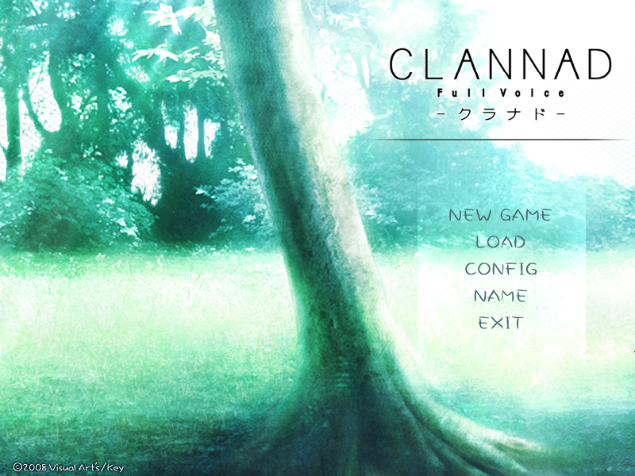

# gal-engines

Five galgame engines, ported to run natively on Apple Silicon — and one manager
that knows how to start any of them.

Every engine here runs a real game on an M1 Mac, natively: no Wine, no Rosetta,
no virtual machine. Each was a separate piece of work with its own build system
and its own way of breaking; what they share is this repository and `gal`.

| | Engine | Port | Real game it runs |
|---|---|---|---|
| ① | **NScripter** → [OnscripterYuri](OnscripterYuri/) | fork, CMake | official demo + SDK samples; save/load round-trip |
| ② | **KiriKiri** → [kirikiroid2-mac](kirikiroid2-mac/) | port of TJS2/XP3 | a real KAG3 project: title → click → chapter, from a folder and from `data.xp3` |
| ③ | **RealLive** → [rlvm](rlvm/) | revived (SDL3) | CLANNAD Full Voice: title, sprites, dialogue, system menu |
| ④ | **Ethornell/BGI** → [openbgi](openbgi/) | new darwin backend | official trial: title screen renders |
| ⑤ | **Artemis** → [artemis](artemis/) | **written from scratch** | real archives read and extracted (pf6/pf8) |



*CLANNAD Full Voice, rendered by the RealLive port in this repository.*

## Quick start

```bash
brew install cmake scons sdl2 sdl2_image sdl2_mixer sdl2_ttf sdl3 sdl12-compat \
             lua jpeg-turbo libpng lz4 ffmpeg bzip2 boost gettext libogg libvorbis libsndfile

git clone <this repo> && cd gal-engines
./build-all.sh                     # build all five, then check what can be checked
```

Without game data the data-driven checks report `跳过` rather than failing, so a
fresh clone still builds and tells you exactly what it could not exercise:

```
构建
  ✓ nscripter      build/onsyuri
  ✓ bgi            openbgi-src/bin/bgi
  ✓ kirikiri       build/krkrrun
  ✓ artemis        build/agame
  ✓ reallive       build/rlvm.app
自检
  ✓ reallive       260 个单元测试通过
  ✓ artemis        pfs/ast/runtime 自检 + 12 帧渲染
  · nscripter      需要 testdata/lifegame（见 docs/DATA.md）
  ...
通过 2，失败 0，跳过 5
```

Point it at game data you own (see [docs/DATA.md](docs/DATA.md)) and every check
runs:

```bash
./build-all.sh --check --data ~/games/gal-testdata     # 通过 7，失败 0
```

## The manager

```bash
./gal/gal engines                  # what each engine is, and whether it is built
./gal/gal add <dir|file.xp3>       # add a game; the engine is detected from its files
./gal/gal list                     # the library
./gal/gal play <name>              # launch it
./gal/gal verify <name>            # run it for a few seconds and judge what happened
./gal/gal play <name> --dump x.bmp # headless: let the engine draw, save the frame
./gal/gal doctor                   # are the binaries and tools in place?
```

`verify` judges by behaviour, not by "no crash": it fails a game whose engine
prints script exceptions, and it separates engine failures from the harmless
warnings an engine makes about optional assets it can live without.

## How it is built

Each engine keeps its own build system and its own `BUILD_NOTES.md` recording
what actually broke and why — the OpenBGI OS layer, the KiriKiri texture path
that answered for every format, RLVM's SDL3 move, Artemis's PFS cipher. Start at
[docs/BUILD.md](docs/BUILD.md); the reproduction record is
[docs/REBUILD.md](docs/REBUILD.md).

| Engine | Build | Notable dependency |
|---|---|---|
| OnscripterYuri | `cmake -B build && cmake --build build` | SDL2, Lua |
| kirikiroid2-mac | same | SDL2_mixer, jpeg-turbo, lz4, ffmpeg |
| rlvm | `scons --release` | sdl12-compat (SDL 1.2 API over SDL3) |
| openbgi | `make PLATFORM=darwin` | SDL2 |
| artemis | `cmake -B build && cmake --build build` | SDL2, CoreText |

## Documentation

- [docs/STATUS.md](docs/STATUS.md) — what works, engine by engine, with commands
- [docs/BUILD.md](docs/BUILD.md) — dependencies and the macOS-specific adaptations
- [docs/DATA.md](docs/DATA.md) — where test data comes from; how to obtain it
- [docs/VERIFICATION.md](docs/VERIFICATION.md) — acceptance records with machine and date
- [docs/video-backend.md](docs/video-backend.md) — NScripter movie backend contract
- [harness/](harness/) — save/load round-trip automation (save → SIGKILL → load)
- [bench/](bench/) — CPU/RSS baseline and film fixtures

## What is not included

- **No game data.** Not one byte of a commercial title ships here; the engines
  are useless without data you own. See [docs/DATA.md](docs/DATA.md).
- **Not a piracy tool.** These are compatibility ports. Nothing here circumvents
  DRM, and no archive keys are distributed.

## Licences

The bundled engines keep their own licences — GPL-2.0 (OnscripterYuri, OpenBGI),
GPL-3.0-or-later (rlvm), BSD-style (KiriKiri). Code written for this project
(`gal`, `build-all.sh`, `artemis/`, docs) is MIT. Full details:
[THIRD-PARTY.md](THIRD-PARTY.md), [LICENSE](LICENSE).

## Known gaps

- **Artemis** reads and extracts real archives but does not yet render a real
  game's scenes; its acceptance is the archive layer plus self tests.
- **KiriKiri** plays a chapter but each message needs a click — no auto-play.
- **NScripter** movie playback goes through AVFoundation/libmpv and is proven on
  a test film, not on a shipped title's movie.
