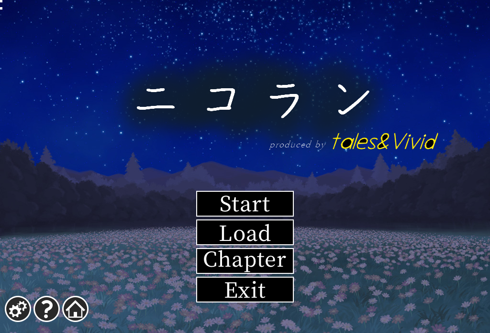
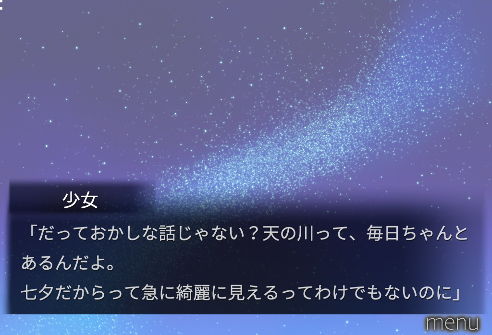

[](https://github.com/hyl64/gal-engines/actions/workflows/build.yml)

# gal-engines — 在 M1 Mac 上跑 galgame

五款主流 galgame 引擎的 macOS arm64 原生适配，加一个统一的管理器。
每个目录是一个独立的仓库，各有一份 BUILD_NOTES 记录踩过的坑。

```
gal-engines/
├── OnscripterYuri/   ① NScripter      → OnscripterYuri（移植）      ✅ 可运行
├── kirikiroid2-mac/  ② KiriKiri        → Kirikiroid2（移植）        🚧 部分
├── rlvm/             ③ RealLive        → RLVM（移植，另一会话）      ⬜ 无产物
├── openbgi/          ④ Ethornell/BGI   → OpenBGI（新增后端）        ✅ 可运行
├── artemis/          ⑤ Artemis         → 从零重写                  🚧 容器通真实数据
├── gal/              统一管理器（建库/选引擎/启动/verify/prep/savetest）
├── harness/          存读档往返自动化（save→kill→load→判定）
├── bench/            效率基准与标准影片夹具
├── testdata/         真实游戏数据（官方免费 SDK、体验版、作者免费发布作品）
└── DESIGN-VIDEO.md   影片后端与预处理管线的跨任务契约
```

## 用法

```bash
./gal/gal doctor                  # 检查每个引擎的二进制是否就位
./gal/gal engines                 # 五个引擎的状态一览
./gal/gal add <目录>              # 建库，自动识别引擎
./gal/gal list                    # 库里的游戏
./gal/gal play <名字>             # 启动（launch 亦可）
./gal/gal verify <名字>           # 跑一遍，判断「是否真的跑起来」
./gal/gal play <名字> --dump x.bmp # 无头跑十几秒，把引擎画的画面存下来（② BGI）
./gal/gal prep <名字>             # 把游戏里的 .avi/.mpg（含 arc.nsa 里的）转码到 _video/
./gal/gal savetest <名字>         # 存读档往返测试（转发 harness/run_savetest.sh）
./harness/run_savetest.sh         # 同一件事，不走 gal
./bench/bench.sh <binary> <game>  # 静态页 CPU/RSS 基线
./OnscripterYuri/test/video/run_acceptance.sh   # 影片后端 8 项验收
```

`verify` 的判定是**按运行时长**：进程在 2 秒内退出就算「没跑通」，避免脚本一启动
就报错退出却被当成成功。

## 验收（`gal verify`，逐个真实数据）

| 引擎 | 数据 | 结论 |
|---|---|---|
| ① NScripter | `testdata/lifegame`（官方演示） | **可以运行** |
| ① NScripter | 官方 SDK 四个样例 | **可以运行** |
| ② KiriKiri | `testdata/kag3-sample`（KAG3 3.32 官方框架 + first.ks） | **可以运行** |
| ④ Ethornell | `testdata/bgi-trial`（《遥か碧の花嫁に》官方体验版） | **可以运行** |
| ⑤ Artemis | 三套真实归档（pf6/pf8，2,884 句台词） | **标题→正文可玩，60 FPS** |
| ③ RealLive | CLANNAD Full Voice（231 剧本，4 GB） | **260/260 单测；标题/立绘/中文台词/系统菜单** |

**四个引擎在真实数据上通过验收**；引擎⑤ 从零实现，已接手三套真实作品。

完整的状态表、每项能力与已知缺口见 [docs/STATUS.md](docs/STATUS.md)。

## 各引擎的证据

### ① NScripter — 完成（含影片后端）
- 二进制：`OnscripterYuri/build/onsyuri`（arm64，651 KB）
- 真实数据：**5 套全部进入主循环** —— `lifegame`（官方演示）+ NScripter 官方 SDK
  的四个 Lua 示例
- 补丁：macOS 没有 `/usr/share/fonts`，加了系统字体回退链（`ONS_FONT` 环境变量优先，
  然后 Hiragino Sans GB → Arial Unicode → AppleSDGothicNeo → Hiragino Sans W3）
- **`mpegplay` / `avi` / `movie` 不再是 disabled**：原先 Mac 构建没有
  `USE_SMPEG`/`USE_AVIFILE`，这三个命令编译期就被砍掉。现在走自研后端：
  `_video/video_map.json` 侧车映射 → AVFoundation/VideoToolbox 硬解（主路）
  → libmpv dlopen 兜底 → 都失败才回到原来的跳过行为。验收 8/8 绿：
  `OnscripterYuri/test/video/run_acceptance.sh`
- **存读档跨进程验证通过**：变量 `%0` 存进 slot、`kill -9`、新进程读回，
  判据是变量值决定播哪个片源。`./harness/run_savetest.sh` → PASS
- **存档落盘位置已摸清**（`harness/results.md`）：没有 `<game>/sav/` 时引擎
  只写自己的私有格式并打印 `can't open save file`；`gal launch` 现在会预建
  该目录，NScripter 兼容存档才会真的写出来

### ④ Ethornell / BGI — 补全完成，真实商业游戏标题→正文可玩 🏆
- 二进制：`openbgi/openbgi-src/bin/bgi`（arm64）
- 新增完整的 **darwin(SDL2) 后端**（约 4000 行，12 个文件），16/16 单元测试通过
- **arm64 没有 CPUID 指令**，而 BGI 启动时会查 CPU 型号——用软件模拟 CPUID 解决
- 真实数据：官方体验版《遥か碧の花嫁に》被正确识别（`engine profile 1.669`），
  从 `sysgrp.arc` 解出 408 张 PNG（含 1920×1080 画廊图），剧本可反汇编
- **显示链路完整**：绘制 → 表面 → blit → 窗口纹理 → SDL 呈现 → 屏幕，
  窗口里能看到游戏画面（`openbgi/screenshots/window-presented.png`）
- **真实商业游戏的标题画面已在 arm64 上渲染**：`openbgi/screenshots/haruka-title.png`
  —— 《遥か碧の花嫁に 体験版》的完整标题画面（三位角色立绘、LOGO、六个菜单按钮、
  确认对话框），1920×1080、44 万种颜色、日文全部正确
- 关键修复：游戏表里的**产品名**（`HarukaAonoHanayomeniTV`）——没有它引导程序会
  主动退出；以及一个把**引擎绘制表面直接 dump** 的诊断（`BGI_DUMP_STAGE`），
  绕开 SDL 呈现才知道画面其实一直是好的
- **2026-10-25 第二轮补全（本轮）**：
  - darwin UI 层：子窗口（`B0 1x`）、文本输入框（`B0 2x`）、命名/资料/选择对话框（`B0 84/85/87/8C/8F`）、文件/文件夹对话框（`B0 8B`、`81 38/3A`）、调试器窗口
  - 影片：档案内影片 `92 F0`（真 584MB `movie_op.mpg` → 123360ms、178 帧/6s、首次解包 675ms/缓存 127ms）、视频纹理 `91 F0..F7`/`92 F2..F5`、外部影片 `90 F0` 验证
  - CBG alpha：CBG v2 **mode 2 Huffman alpha 平面**实现（1.669 exe 反汇编逐条对照 + 自写编码器往返 + 全量 alpha 直方图）
  - 3D：`90 5D` 三轴旋转/透视精灵（单应性渲染，60 组参数与 `90 5C` 逐像素 0 diff）
  - 效率：NEON blit（3 条内核）+ 整帧直通上屏，**满载 CPU −39.4%**，静置 ~2%
  - 验收：`openbgi/verify.sh --deep` 全绿；**21/21 单测**；真实游戏从标题点进正文（`screenshots/haruka-ingame-story.png`）
  - 细节：`openbgi/BUILD_NOTES.md`

### ② KiriKiri — 平台件齐全
- 11 个工具：`tjsc`（跑 TJS 脚本）、`krkrpack`（XP3 解包）、`krkrview`（取图）、
  `krkrfont`（渲染字形）、`krkrtext`（位图写字）、`krkrrun`（跑引擎脚本）、
  `krkrpresent`（上屏）、`krkrblit`、`krkrscene`、`krkrbitmap`、`krkrscript`
- 打通：TJS2 脚本引擎、XP3 归档（往返逐字节一致）、存储层、引擎自带的**软件渲染器**
  （4414 行）、位图层、日文字体、**文字绘制**、窗口、**图层系统**
- 证据：`krkrrun tests/compose.tjs --screenshot` 输出 640×480 合成帧；
  子图层也通了（`screenshots/child-layer-composed.png`：父层填充 + 子层文字）
- **显示链路完整**：脚本 → 窗口 → 图层树 → 图层管理器合成 → 绘制设备 → 帧
- **真实 KAG3 框架能加载自己的模块**：`KAG : 3.32` / `Kirikiri : 2.32`，
  MessageLayer / Menus / DefaultMover / MainWindow 四个模块都执行成功
  （「スクリプトの読み込みに 23ms」），停在缺少 `MenuItem` 原生类
- **KAG 形状的引导脚本已跑通**：`tests/minikag/`（system.tjs 建窗口与图层 +
  剧本逐行推进）→ `screenshots/minikag-scenario.png`，三行日文台词合成上屏
- **真实 KAG3 剧本已上屏** 🏆：`first.ks` 执行 → 「こんにちは。」绘制并读回
  （`kirikiroid2-mac/screenshots/kag3-first-line.png`），数据是 KAG3 官方框架
- 跑法：`cd testdata/kag3-sample && KRKR_LOOP_SECONDS=5 SDL_VIDEODRIVER=dummy \
  kirikiroid2-mac/build/krkrrun startup.tjs --screenshot out.bmp`
- **真实 KAG 游戏可交互**：点击标题的 start 按钮 → 进入 `1.ks` 正文，
  对话框显示台词（`kirikiroid2-mac/screenshots/real-game-story.png`）
- **真实 KAG 游戏的标题画面完整渲染**：`kirikiroid2-mac/screenshots/real-game-title.png`
  （真实 `bg0.jpg` 背景 + KAG 绘制的 start / setting 按钮，1280×720，9.2 万色）
- **直接从归档跑**（真实游戏的发布形态）：`krkrrun kag3.xp3` —— 把归档设为当前目录
  （存储名里 `>` 表示「归档内部」），KAG3 工程 30 个文件全在 xp3 里也能跑
  （`screenshots/archive-launch.png`）

### ⑤ Artemis — 从零重写，已接手真实游戏数据

Artemis 没有开源实现，全部自己写。**2026-10-25 起，这套实现有了真实作品数据**：
三套官方/作者公开免费发布的内容，来源、哈希与复核记录在
[artemis/DATA_SOURCES.md](artemis/DATA_SOURCES.md)，实跑数据见
[bench/artemis/RESULTS.md](bench/artemis/RESULTS.md)。

| 数据 | 形态 | 归档实测 |
|---|---|---|
| ニコラン プロトタイプ（tales&Vivid，同人免费完整作品） | `pf6` 明文单卷 44,161,036 B | 125 条，73/73 PNG chunk CRC 正确，1024×698 与 `system.ini` 吻合 |
| ラズベリーキューブ WEB体験版（まどそふと/iMel 官方免费体験版） | `pf8` 加密单卷 222,878,531 B | 2891 条，`SHA1(index)` 按**文件内相对位置**异或 |
| ヘンタイ・プリズン 山岸姫瑠ミニアペンド（Qruppo 官方免费追加数据） | `pf8` 分卷 `HENPRI.pfs.060` 211,602,406 B | 1682 条，真·PC 版 `.pfs.NNN` 形态 |

**七层里六层有真数据背书**：

| 层 | 工具 | 真实数据上的状态 |
|---|---|---|
| `.pfs` 归档（pf6 明文 / pf8 XOR / `.pfs.NNN` 分卷） | `pfstool` | ✅ 三形态全通，1682 条整卷提取 |
| 内容判型（不看扩展名） | `pfstool type` / `--types` | ✅ ttf/png/jpeg/ogg/text/ast-lua/asb/ini/ipt 各方言 |
| `.ast`（Lua 表，两种顶层变体） | `asttool` | ✅ 59/59 真实文件 |
| `.asb`（真字节码） | `asbtool` | ✅ 3 个真样本 EXACT 到 EOF |
| `.iet`（KAG 标签脚本，CP932） | `agame` 执行器 | ✅ 三段树：boot → 宏表 → 场景 |
| `.ipt`（四种方言 + 合成图） | `iettool` | ✅ 136 checks，4 组变异验证 |
| **真实第一屏** | `agame` | ✅ 见下图；**从归档直接跑，0 解包** |
| 逐字/补间/帧动画/亮度/震动 | `fxtool` + `agame` | ✅ 6 项像素级断言，7 组变异验证 |
| 音频（`.ogg` + `.sli` 循环点 + A-B repeat） | `audiotool` + `agame` | ✅ 320× 实时，WAV 可验，`afinfo` 复核 |
| 真实 `.ast` 解析与链完整性 | `agame --ast-info` | ✅ 59 文件 / 13,133 block，`chain_defects=0` |




上：**真实标题画面** —— 游戏自己的标题图、`produced by tales&Vivid`、Start/Load/Chapter/Exit
四个按钮（`[button]` 底板+文字两层，命中矩形从 stage 现算）、左下三个图标。
菜单入口不是硬编码的，是从 `first.iet` 自己最后一条 `[jump]` 读出来的（`main.iet:menu`）。

下：**真实第一屏** —— 真实剧本 + 真实银河背景 + 游戏自带 GenShin 字体，
1024×698（尺寸取自游戏自己的 `system.ini`），82147 色，文字像素 29216，61 个字形。

**可玩性**：`--play` 打开真窗口（cocoa），帧间隔 p50 = p95 = **17.00 ms**（60 FPS 节拍），
帧工作 p50 **3 ms**，点 Start 进正文，`[select]` 选择支端到端可选，真声卡输出
（MacBook Pro 扬声器 48 kHz，underrun 0）。无头模式下同一脚本同一输入**帧哈希序列可复现**。

```bash
cd artemis
SDL_VIDEODRIVER=dummy ./build/agame --script scenario/scene.iet \
  --archive ../testdata/artemis-nicolan/root.pfs \
  --frames screenshots --frame-prefix real-first-screen-p \
  --out screenshots/real-first-screen.png --pages 4
# → canvas: 1024x698 (from the game's system.ini)
# → boot first.iet: 188 commands, 112 macros, 6 message styles
# → first-screen text pixels: 29216, glyphs: 61, speaker="少女"
# → verdict: first screen verified
```

#### 效率（真实数据、真实二进制、≥5 次重复）

| 卖点 | 数字 |
|---|---|
| 打开 202 MB 归档 | **0.40 ms**，常驻只涨 **540 KiB（0.26%）**（mmap 真的生效） |
| 列 1682 条目录 | 10.4 ms，其中容器层只占 **1.8 ms** |
| 取一张 2 MB event CG | **0.12 ms**（优化前 2.1 ms，**19×**） |
| 解档 202 MB 加密卷 | **CPU 37 ms**（5,405 MiB/s）；写盘版 370 ms |
| 73 张真实 PNG 全解 | **166 ms**（189 MiB/s），比系统 `sips` 快 **2.2×** |
| 真实第一屏（从归档跑） | 首帧 **50.9 ms**，峰值 RSS 59.9 MiB |
| 「不解包直接跑」vs「先解包再跑」 | **50.9 vs 55.2 ms**（归档更快），画面逐字节相同 |
| 渲染每帧 | **5.3–6.0 ms** |
| 音频解码 | **320× 实时**，RSS 零增长；离线混音出 WAV，`afinfo` 复核 |
| 亮度渐变 `sfade` | 1024×698 全帧 **0.62–0.75 ms**（60fps 预算的 4%），`gain=1000` 零成本 |

两个关键澄清：
- 早期看到的「335 ms/帧」是**每帧落盘 PNG** 的成本（PNG 编码 205 ms），不是渲染慢。
  真实运行时只有 5–6 ms/帧，落盘只发生在截图/存档缩略图。
- 解档吞吐从 792 MiB/s 提到 5,405 MiB/s（**6.8×**），是把 `ApplyKey` 的逐字节 XOR
  改成 20 字节分组（密钥周期就是 20）。补丁先证等价（368,734 个用例 0 处字节不一致）
  再谈性能。详见 [bench/artemis/RESULTS.md](bench/artemis/RESULTS.md)。

#### 真实数据推翻了四个旧假设

1. **`.ast` 是 Lua 表**，不是字符串键字典：
   `astver = 2.0` + `ast = { block_00000 = { {"bg", file="…", lv=9}, {"text"},
   text = { ja = { {"「台词」"} } }, linknext = "block_00001" } }`。
   命令是「首个元素为命令名的数组」，剧情单元靠 `linknext` 串链。
2. **`.iet` 不是图片，是 KAG 标签脚本文本**（Shift-JIS）：
   `*start` / `[lyc id="0" file="bgimage/milkeyway"]` / `[trans type="1" time="2000"]`。
   三套数据里 `.iet` 全部是脚本，图片其实是普通 `.png`/`.jpg`。
3. **剧本三种形态并存**，不存在「省掉整个 VM」：`.iet` 是文本、`.ast` 是 Lua 表、
   **`.asb` 是字节码**（真样本魔数 `41 53 42 00 00` + 条目数，命令/标签两种记录）。
4. **`.ipt` 有四种方言**，只有一种才是合成图：图集矩形表（`ok_qs = "576,0,424,36"`）、
   纯数据点表（地图热点）、`mode="anime_full"` 动画、`mode="cut"|"diff"` 合成图。
   **必须按内容判型，按扩展名判型会全线翻车。**

#### 还没做到的

- **存档/读档、backlog、已读标记**：未做（`save.asb` 能解析，语义没实现）。
- **仍未接入的标签**：`extrans`×34（交叉淡入要两张图）、`colortone`×141（色彩矩阵）、
  `movie`×5、`excall`×56（跨 `.ast` 调用）、`[select]` 选项列表（语料里没有可解析的
  选择点，不编造）。全部逐条计数并报位置，不静默。
- **`scetween` 的 80 个 `mode="add"`**：tween 曲线已实现，但 `type` 指向的 15 个 GUI
  状态槽在本移植里还没有对应图层，计为 unmatched。
- **`.psb`（Emote 立绘）**：三套语料里数量为 0，**没有真实数据可验证**，
  只做了签名识别。这条不能写成已通过。
- **跨卷查找**：只有 Qruppo 的 `.060` 单卷，无多卷数据可测。
- **`.ast` 的外置台词**（`lang_NNNNN`）：语料没带对应 lang 文件，能识别但打不开。

完整清单与证据命令见 [artemis/DATA_SOURCES.md](artemis/DATA_SOURCES.md)，
实跑数据见 [bench/artemis/RESULTS.md](bench/artemis/RESULTS.md)。

### ③ RealLive — 不在本会话
`rlvm/` 是上游源码，由另一个会话负责移植，目前没有产物。

## 构建

完整复现步骤见 [docs/BUILD.md](docs/BUILD.md)，实测记录见 [docs/REBUILD.md](docs/REBUILD.md)。

一条命令构建全部并自检：

```bash
./build-all.sh          # 四个引擎构建 + 四个自检
./build-all.sh --check  # 只跑自检
```

输出（本轮实测）：

```
构建
  ✓ nscripter     build/onsyuri
  ✓ bgi           bin/bgi
  ✓ kirikiri      build/krkrrun
  ✓ artemis       build/agame
自检
  ✓ nscripter     official demo still running after 3s
  ✓ kirikiri      KAG3 loads its scenario
  ✓ bgi           the trial's profile is recognised
  ✓ artemis       pfs, ast and the runtime self tests
通过 8，失败 0
```

也可以各自独立构建：

```bash
cd OnscripterYuri && cmake -B build -DCMAKE_BUILD_TYPE=Release && cmake --build build -j2
cd openbgi/openbgi-src && make
cd kirikiroid2-mac && cmake -B build -DCMAKE_BUILD_TYPE=Release && cmake --build build -j2
cd artemis && cmake -B build -DCMAKE_BUILD_TYPE=Release && cmake --build build -j2
```

依赖（Homebrew）：`sdl2 freetype libpng lz4 opencv@4 oniguruma libarchive ffmpeg`。

## 缺什么

验收标准是「能在这台机器上跑通至少一款真实游戏数据」。目前：

- ①④ 有真实数据且跑通（或跑到上游自身的极限）
- ② **缺游戏数据**：需要 `data.xp3`
- ⑤ **有真实数据且已渲染出真实第一屏**（三套，见上）。容器、内容判型、`.ast`、
  `.asb`、`.iet`、`.ipt` 六层都有真数据背书；缺的是音频、存档、30 种未动作标签
- ③ 等另一个会话

⑤ 目前的准确说法是「**能读真实归档、能解析真实脚本、能画出真实画面**」，
还不能说「完整游戏可玩」——缺音频、存档与大部分转场特效。

### 真实数据里没覆盖到的

- **`.psb`（Emote 立绘）三套样本里数量为 0** —— 这条路只能按 FreeMote/GARbro 的
  规格实现，没有真数据可验证，不能写成「已通过」。
- **`.pfs.NNN` 只有 Qruppo 的 `.060` 单卷**，跨卷查找（同一作品的 `000`~`005`
  分散在不同卷）没有真数据可测。
- **`.iet` 图片**这个问题本身是伪命题：三套语料里 `.iet` 全是 KAG 脚本文本，
  图片是普通 png/jpg + `.ipt` 描述符。早先「`.iet` 图像格式缺资料」的说法已作废。

